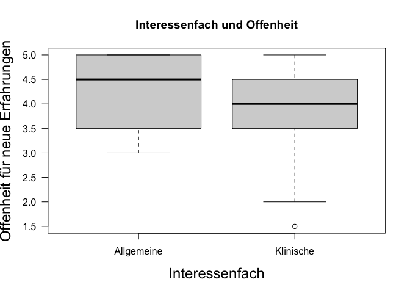
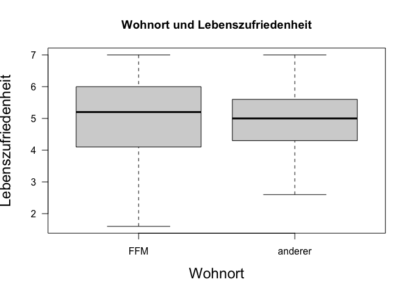
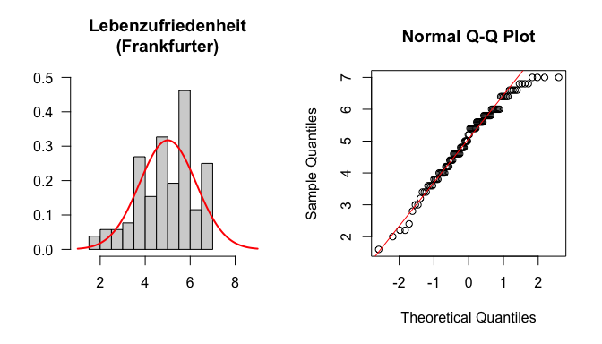
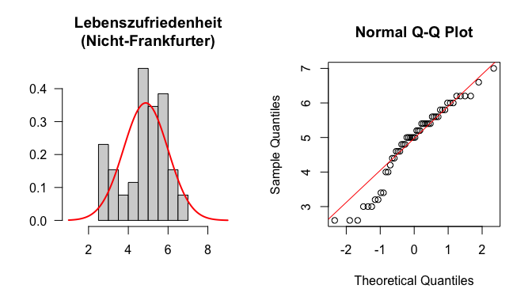

## Vorbereitung

> Laden Sie zunächst den Datensatz `fb26` von der pandar-Website. Alternativ können Sie die fertige R-Daten-Datei [<i class="fas fa-download"></i> hier herunterladen](/daten/fb26.rda). Beachten Sie in jedem Fall, dass die [Ergänzungen im Datensatz](/lehre/statistik-i/gruppenvergleiche-unabhaengig/#prep) vorausgesetzt werden, teils inklusive derer, die erst im Beitrag vorgenommen werden. Die Bedeutung der einzelnen Variablen und ihre Antwortkategorien können Sie dem Dokument [Variablenübersicht](/lehre/statistik-i/variablen.pdf) entnehmen.

**Datenaufbereitung**


``` r
#### Was bisher geschah: ----

# Daten laden
load(url('https://pandar.netlify.app/daten/fb26.rda'))

# Nominalskalierte Variablen in Faktoren verwandeln
fb26$hand_factor <- factor(fb26$hand,
                             levels = 1:2,
                             labels = c("links", "rechts"))
fb26$fach <- factor(fb26$fach,
                    levels = 1:5,
                    labels = c('Allgemeine', 'Biologische', 'Entwicklung', 'Klinische', 'Diag./Meth.'))
fb26$ziel <- factor(fb26$ziel,
                        levels = 1:4,
                        labels = c("Wirtschaft", "Therapie", "Forschung", "Andere"))
fb26$wohnen <- factor(fb26$wohnen, 
                      levels = 1:4, 
                      labels = c("WG", "bei Eltern", "alleine", "sonstiges"))
fb26$fach_klin <- factor(as.numeric(fb26$fach == "Klinische"),
                         levels = 0:1,
                         labels = c("nicht klinisch", "klinisch"))
fb26$ort <- factor(fb26$ort, levels=c(1,2), labels=c("FFM", "anderer"))
fb26$job <- factor(fb26$job, levels=c(1,2), labels=c("nein", "ja"))
fb26$unipartys <- factor(fb26$uni3,
                             levels = 0:1,
                             labels = c("nein", "ja"))

# Rekodierung invertierter Items
fb26$mdbf4_r <- -1 * (fb26$mdbf4 - 4 - 1)
fb26$mdbf11_r <- -1 * (fb26$mdbf11 - 4 - 1)
fb26$mdbf3_r <-  -1 * (fb26$mdbf3 - 4 - 1)
fb26$mdbf9_r <-  -1 * (fb26$mdbf9 - 4 - 1)
fb26$mdbf5_r <- -1 * (fb26$mdbf5 - 4 - 1)
fb26$mdbf7_r <- -1 * (fb26$mdbf7 - 4 - 1)

# Berechnung von Skalenwerten
fb26$wm_pre  <- fb26[, c('mdbf1', 'mdbf5_r', 
                        'mdbf7_r', 'mdbf10')] |> rowMeans()
fb26$gs_pre  <- fb26[, c('mdbf1', 'mdbf4_r', 
                        'mdbf8', 'mdbf11_r')] |> rowMeans()
fb26$ru_pre <-  fb26[, c("mdbf3_r", "mdbf6", 
                         "mdbf9_r", "mdbf12")] |> rowMeans()

# z-Standardisierung
fb26$ru_pre_zstd <- scale(fb26$ru_pre, center = TRUE, scale = TRUE)
```

***

## Aufgabe 1
Unterscheiden sich Studierende, die sich für Allgemeine Psychologie (Variable "fach") interessieren, im Persönlichkeitsmerkmal Offenheit für neue Erfahrungen (auch Intellekt, "offen") von Studierenden, die sich für Klinische Psychologie interessieren? Normalverteilung des Merkmals in der Population darf angenommen werden. 

<details><summary>Lösung</summary>

**Deskriptivstatistische Beantwortung der Fragestellung: grafisch**


``` r
data1 <- fb26[ (which(fb26$fach=="Allgemeine"|fb26$fach=="Klinische")), ]
data1$fach <- droplevels(data1$fach)
boxplot(data1$offen ~ data1$fach,
        xlab="Interessenfach", ylab="Offenheit für neue Erfahrungen", 
        las=1, cex.lab=1.5, 
        main="Interessenfach und Offenheit")
```

<!-- -->


**Deskriptivstatistische Beantwortung der Fragestellung: statistisch**


``` r
# Überblick

library(psych)
describeBy(data1$offen, data1$fach)
```

```
## 
##  Descriptive statistics by group 
## group: Allgemeine
##    vars  n mean   sd median trimmed  mad min max range  skew kurtosis   se
## X1    1 26 4.21 0.83    4.5    4.25 0.74   3   5     2 -0.41    -1.54 0.16
## ------------------------------------------------------------ 
## group: Klinische
##    vars  n mean   sd median trimmed  mad min max range  skew kurtosis   se
## X1    1 65 3.83 0.88      4     3.9 0.74 1.5   5   3.5 -0.63    -0.31 0.11
```

``` r
# Berechnung der empirischen Standardabweichung, da die Funktion describeBy() nur Populationsschätzer für Varianz und Standardabweichung berichtet

offen.A <- data1$offen[(data1$fach=="Allgemeine")]
sigma.A <- sd(offen.A)
n.A <- length(offen.A[!is.na(offen.A)])
sd.A <- sigma.A * sqrt((n.A-1) / n.A)
sd.A 
```

```
## [1] 0.810663
```

``` r
offen.B <- data1$offen[(data1$fach=="Klinische")]
sigma.B <- sd(offen.B)
n.B <- length(offen.B[!is.na(offen.B)])
sd.B <- sigma.B * sqrt((n.B-1) / n.B)
sd.B
```

```
## [1] 0.869469
```

Mittelwert der Allgemeinen Psychologen (_M_ = 4.21, _SD_ = 0.81) unterscheidet sich deskriptivstatistisch vom Mittelwert der Klinischen (_M_ = 3.83, _SD_ = 0.87).


**Voraussetzungsprüfung: Normalverteilung**

Nicht nötig, da Normalverteilung in der Population angenommen werden darf (s. Aufgabenstellung). 

**Hypothesen**

* Art des Effekts: Unterschiedshypothese  
* Richtung des Effekts: Ungerichtet $\rightarrow$ ungerichtete Hypothesen  
<!-- * Größe des Effekts: Unspezifisch   -->

Hypthesenpaar (statistisch):  

* $H_0$: $\mu_\text{Allgemeine} =   \mu_\text{Klinische}$ bzw. $\mu_\text{Allgemeine} -   \mu_\text{Klinische} = 0$
* $H_1$: $\mu_\text{Allgemeine} \ne \mu_\text{Klinische}$ bzw. $\mu_\text{Allgemeine} - \mu_\text{Klinische} \ne 0$

**Spezifikation des Signifikanzniveaus** 

$\alpha = .05$

**Voraussetzungsprüfung: Varianzhomogenität**


``` r
library(car)
leveneTest(data1$offen ~ data1$fach)
```

```
## Levene's Test for Homogeneity of Variance (center = median)
##       Df F value Pr(>F)
## group  1  0.0236 0.8783
##       89
```

``` r
levene <- leveneTest(data1$offen ~ data1$fach)
f <- round(levene$`F value`[1], 2)
p <- round(levene$`Pr(>F)`[1], 3)
```

_F_(1, 89) = 0.02, _p_ = 0.878 $\rightarrow$ Das Ergebnis ist nicht signifikant, die $H_0$ wird beibehalten und Varianzhomogenität angenommen.

**Durchführung des _t_-Tests**


``` r
t.test(data1$offen ~ data1$fach,           # abhängige Variable ~ unabhängige Variable
       #paired = F,                   # Stichproben sind unabhängig 
       alternative = "two.sided",         # zweiseitige Testung
       var.equal = T,                # Varianzhomogenität ist gegeben (-> Levene-Test)
       conf.level = .95)             # alpha = .05 
```

```
## 
## 	Two Sample t-test
## 
## data:  data1$offen by data1$fach
## t = 1.9023, df = 89, p-value = 0.06037
## alternative hypothesis: true difference in means between group Allgemeine and group Klinische is not equal to 0
## 95 percent confidence interval:
##  -0.01695911  0.77849757
## sample estimates:
## mean in group Allgemeine  mean in group Klinische 
##                 4.211538                 3.830769
```


**Formales Berichten des Ergebnisses**

Es wurde untersucht, ob sich Studierende, die sich für Allgemeine Psychologie interessieren, im Persönlichkeitsmerkmal Offenheit für neue Erfahrungen von Studierenden, die sich für Klinische Psychologie interessieren, unterscheiden. Deskriptiv liegt ein solcher Unterschied vor: Die Mittelwerte betragen 4.21 (Allgemeine, _SD_ = 0.81) und 3.83 (Klinische, _SD_ = 0.87). Der entsprechende _t_-Test zeigt jedoch ein nicht signifikantes Ergebnis (_t_(_df_ = 89, zweis.) = 1.9, _p_ = 0.06). Die Nullhypothese konnte nicht verworfen werden und wird beibehalten. Die Studierenden unterscheiden sich im Mittel im Persönlichkeitsmerkmal 'Offenheit für neue Erfahrungen' nicht, abhängig davon, ob sie sich für Allgemeine Psychologie oder für Klinische Psychologie interessieren.

</details>

## Aufgabe 2
Sind Studierende, die außerhalb von Frankfurt wohnen ("ort"), zufriedener im Leben ("lz") als diejenigen, die innerhalb von Frankfurt wohnen? Nehmen Sie an, dass eine Normalverteilungsannahme nicht haltbar ist. 


<details><summary>Lösung</summary>

**Deskriptivstatistische Beantwortung der Fragestellung: grafisch**


``` r
boxplot(fb26$lz ~ fb26$ort,
        xlab="Wohnort", ylab="Lebenszufriedenheit", 
        las=1, cex.lab=1.5, 
        main="Wohnort und Lebenszufriedenheit")
```

<!-- -->

**Deskriptivstatistische Beantwortung der Fragestellung: statistisch**


``` r
library(psych)
describeBy(fb26$lz, fb26$ort)
```

```
## 
##  Descriptive statistics by group 
## group: FFM
##    vars   n mean   sd median trimmed  mad min max range  skew kurtosis   se
## X1    1 104 5.01 1.26    5.2    5.08 1.19 1.6   7   5.4 -0.47    -0.39 0.12
## ------------------------------------------------------------ 
## group: anderer
##    vars  n mean   sd median trimmed  mad min max range  skew kurtosis   se
## X1    1 52 4.87 1.12      5    4.94 0.89 2.6   7   4.4 -0.54    -0.61 0.16
```

``` r
summary(fb26[which(fb26$ort=="FFM"), "lz"])
```

```
##    Min. 1st Qu.  Median    Mean 3rd Qu.    Max. 
##   1.600   4.150   5.200   5.008   6.000   7.000
```

``` r
summary(fb26[which(fb26$ort=="anderer"), "lz"])
```

```
##    Min. 1st Qu.  Median    Mean 3rd Qu.    Max. 
##   2.600   4.350   5.000   4.873   5.600   7.000
```


Sowohl Mittelwert als auch Median der Frankfurter:innen sind deskriptiv minimal höher als der der Nicht-Frankfurter:innen.

**Voraussetzungsprüfung: Normalverteilung**

Wir prüfen die Normalverteilungsannahme für beide Gruppen, wenngleich wir uns bereits gegeben der Aufgabenstellung gegen einen t-Test entschieden haben.


``` r
par(mfrow=c(1,2))
lz.F <- fb26[which(fb26$ort=="FFM"), "lz"]
hist(lz.F, xlim=c(1,9), ylim=c(0,0.5), main="Lebenzufriedenheit\n(Frankfurter)", xlab="", ylab="", las=1, prob=T)
curve(dnorm(x, mean=mean(lz.F, na.rm=T), sd=sd(lz.F, na.rm=T)), col="red", lwd=2, add=T)
qqnorm(lz.F)
qqline(lz.F, col="red")
```



Das Histogramm zeigt eine relativ symmetrische Verteilung, sodass eine Normalverteilungsannahme durchaus vertretbar wäre, allerdings kann man auf Basis des Q-Q-Plots sicherlich argumentieren, dass eine Verletzung der Annahme vorliegt.


``` r
par(mfrow=c(1,2))
lz.a <- fb26[which(fb26$ort=="anderer"), "lz"]
hist(lz.a, xlim=c(1,9), main="Lebenszufriedenheit\n(Nicht-Frankfurter)", xlab="", ylab="", las=1, prob=T)
curve(dnorm(x, mean=mean(lz.a, na.rm=T), sd=sd(lz.a, na.rm=T)), col="red", lwd=2, add=T)
qqnorm(lz.a)
qqline(lz.a, col="red")
```



Das Histogramm zeigt eine relativ symmetrische Verteilung, sodass eine Normalverteilungsannahme durchaus vertretbar wäre, allerdings kann man auf Basis des Q-Q-Plots sicherlich argumentieren, dass eine Verletzung der Annahme vorliegt.


**Hypothesen**

* Art des Effekts: Unterschiedshypothese  
* Richtung des Effekts: Gerichtet $\rightarrow$ gerichtete Hypothesen  
<!-- * Größe des Effekts: Unspezifisch   -->

Hypthesenpaar (statistisch):  

* $H_0$: $\eta_\text{Frankfurter} \ge \eta_\text{nicht-Frankfurter}$ bzw. $\eta_\text{Frankfurter} - \eta_\text{nicht-Frankfurter} \ge 0$  
* $H_1$: $\eta_\text{Frankfurter} < \eta_\text{nicht-Frankfurter}$ bzw. $\eta_\text{Frankfurter} - \eta_\text{nicht-Frankfurter} < 0$

**Spezifikation des Signifikanzniveaus**

$\alpha = .05$

**Durchführung des Wilcoxon-Tests**


``` r
wilcox.test(fb26$lz ~ fb26$ort,           # abhängige Variable ~ unabhängige Variable
       #paired = F,                   # Stichproben sind unabhängig (Default)
       alternative = "less",         # einseitige Testung: Gruppe1 (Frankfurter:innen) < Gruppe2 (Nicht-Frankfurter:innen) 
       conf.level = .95)             # alpha = .05 
```

```
## 
## 	Wilcoxon rank sum test with continuity correction
## 
## data:  fb26$lz by fb26$ort
## W = 2899, p-value = 0.7692
## alternative hypothesis: true location shift is less than 0
```


**Formales Berichten des Ergebnisses** 

Es wurde untersucht, ob in außerhalb Frankfurt wohnende Studierende zufriedener im Leben sind als die innerhalb von Frankfurt wohnenden. Deskriptiv  zeigt sich jedoch bereits, dass die Frankfurter:innen zufriedener sind (_Mdn_ = 5.2, _IQB_ = [4.2 ; 6]) als die Nicht-Frankfurter:innen (_Mdn_ = 5, _IQB_ = [4.4 ; 5.6]). Der entsprechende Wilcoxon-Test zeigt entsprechend ein nicht signifikantes Ergebnis (_W_ = 2899, _p_ = 0.769). Die Nullhypothese konnte somit nicht verworfen werden und wird beibehalten. Die Studierenden, die innerhalb Frankfurt wohnen sind also im Mittel gleich zufrieden oder zufriedener als die Studierenden, welche außerhalb Frankfurts wohnen.


</details>

## Aufgabe 3

Ist die Wahrscheinlichkeit dafür, neben dem Studium einen Job ("job") zu haben, die gleiche für Erstsemesterstudierende der Psychologie, die in einer Wohngemeinschaft wohnen wie für Studierenden, die bei ihren Eltern wohnen ("wohnen")? 

<details><summary>Lösung</summary>
Beide Variablen sind nominalskaliert $\rightarrow \chi^2$-Test

**Voraussetzungen**  

1. Die einzelnen Beobachtungen sind voneinander unabhängig $\rightarrow$ ok
2. Jede Person lässt sich eindeutig einer Kategorie bzw. Merkmalskombination zuordnen $\rightarrow$ ok
3. Zellbesetzung für alle $n_{ij}$ > 5 $\rightarrow$ Prüfung anhand von Häufigkeitstabelle 


``` r
wohnsituation <- fb26[(which(fb26$wohnen=="WG"|fb26$wohnen=="bei Eltern")),] # Neuer Datensatz der nur Personen beinhaltet, die entweder bei den Eltern oder in einer WG wohnen
levels(wohnsituation$wohnen)
```

```
## [1] "WG"         "bei Eltern" "alleine"    "sonstiges"
```

``` r
wohnsituation$wohnen <- droplevels(wohnsituation$wohnen) 
# Levels "alleine" und "sonstiges" wurden eliminiert
levels(wohnsituation$wohnen)
```

```
## [1] "WG"         "bei Eltern"
```

``` r
tab <- table(wohnsituation$wohnen, wohnsituation$job)
tab
```

```
##             
##              nein ja
##   WG           30 19
##   bei Eltern   41 18
```

$\rightarrow n_{ij}$ > 5 in allen Zellen gegeben

**Hypothesen**

* Art des Effekts: Zusammenhangshypothese
* Richtung des Effekts: Ungerichtet
* Größe des Effekts: Unspezifisch

Hyothesenpaar (inhaltlich):  

* $H_0$: Studierende die in einer WG wohnen und Studierende die bei ihren Eltern wohnen haben mit gleicher Wahrscheinlichkeit einen Job bzw. keinen Job.  
* $H_1$: Studierende die in einer WG wohnen und Studierende die bei ihren Eltern wohnen unterscheiden sich in der Wahrscheinlichkeit einen Job bzw. keinen Job neben dem Studium zu haben.  

Hypothesenpaar (statistisch):  

* $H_0$: $\pi_{ij} =    \pi_{i\bullet} \cdot \pi_{\bullet j}$  
* $H_1$: $\pi_{ij} \neq \pi_{i\bullet} \cdot \pi_{\bullet j}$ 

**Durchführung des $\chi^2$-Test in R**


``` r
chisq.test(tab, correct=FALSE)
```

```
## 
## 	Pearson's Chi-squared test
## 
## data:  tab
## X-squared = 0.81229, df = 1, p-value = 0.3674
```


$\chi^2$ = 0.812, df = 1, p = 0.367 $\rightarrow H_0$

**Effektstärke Phi ($\phi$)**


``` r
library(psych)
phi(tab)
```

```
## [1] -0.09
```

**Ergebnisinterpretation**

Es wurde untersucht, ob sich Studierende die in einer WG wohnen und Studierende die bei ihren Eltern wohnen darin unterscheiden, ob sie einen Job haben oder nicht (Job vs. kein Job). Zur Beantwortung der Fragestellung wurde ein Vierfelder-Chi-Quadrat-Test für unabhängige Stichproben berechnet. Der Zusammenhang zwischen Wohnsituation und Berufstätigkeit ist nicht signifikant ($\chi^2$(1) = 0.812, _p_ = 0.367), somit wird die Nullhypothese beibehalten. Der Effekt ist von vernachlässigbarer Stärke ($\phi$ = -0.09). Studierende die in einer WG wohnen und Studierende die bei ihren Eltern wohnen haben also mit gleicher Wahrscheinlichkeit einen Job bzw. keinen Job. 

</details>
